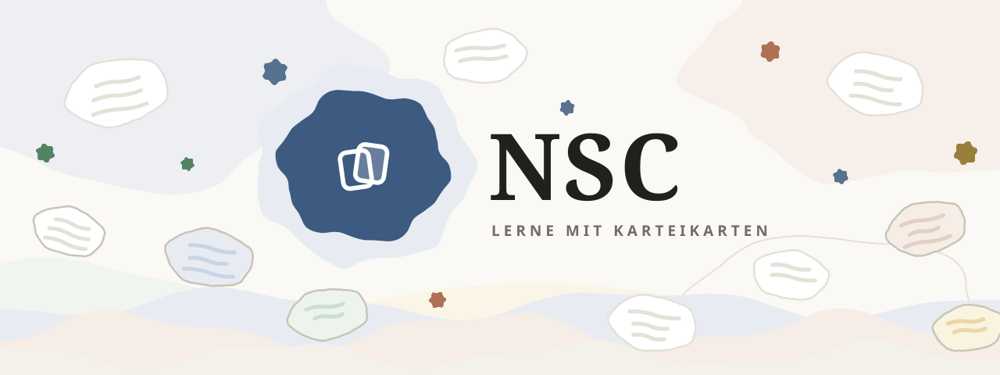
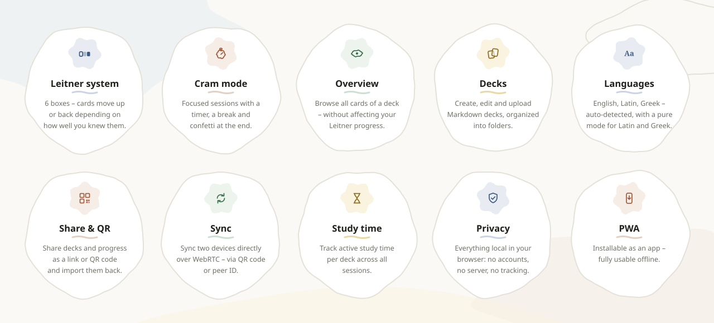
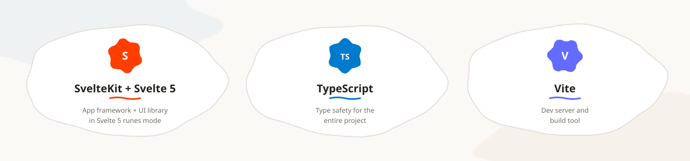

<p align="center">
    
</p>

# NSC

> [!CAUTION]
> Vibe-coded / AI-developed app
> Not yet proofed by a human.


NSC is a local-first flashcard app for learning vocabulary with the Leitner system. Upload your own decks as Markdown, browse them in an overview, or run focused cram sessions with a built-in timer. All data lives in your browser — there is no backend.

## Features

<p align="center">
    
</p>

## Deck format

Decks are plain Markdown files: one H1 title line, then one card per line with front and back separated by the first ` - ` (the back side may itself contain ` - `):

```markdown
# Lektion 22

amo - ich liebe
amas - du liebst
amat - er/sie/es liebt
```

### Inline styling

Card sides support a small allowlist of inline formatting (nesting works; anything not on the list stays literal text):

| Syntax | Renders as |
| --- | --- |
| `` `code` `` | inline `code` |
| `**bold**` | **bold** |
| `*italic*` | *italic* |
| `++underline++` | underlined text |
| `~~strike~~` | ~~strike~~ |
| `==mark==` | highlighted text |
| `^sup^` | superscript |
| `~sub~` | subscript |

Both sides accept one image each via `` (https URLs only, validated on import).

### Hints

Write a hint in square brackets on the **front** side of a card:

```markdown
ἀγάπη [Liebe] - love
```

- **Normal mode** — the brackets are hidden and the hint shows inline on the prompt (`ἀγάπη Liebe`). After you flip the card, the prompt repeats as a small muted line above the answer.
- **Pure mode** (Latin and Greek decks, toggleable in the settings) — brackets *and* hint content are removed from the prompt, so you only see `ἀγάπη`; language diacritics are normalized as well (Greek without breathing marks and tonos, Latin without macrons). The flipped card then shows prompt and answer together.
- **Overview** always shows both sides with the hint content inline and the brackets hidden — pure mode only applies to cram sessions.

Hints are ignored for deck-type auto-detection and for search.

## Tech stack

<p align="center">
    
</p>

Libraries:

- [@sveltejs/adapter-vercel](https://svelte.dev/docs/kit/adapter-vercel) — Deployment adapter
- [PeerJS](https://peerjs.com) — WebRTC device sync
- [qr-code-styling](https://github.com/kozakdenys/qr-code-styling) — Styled QR codes for sharing and sync pairing
- [detectincognitojs](https://github.com/Joe12387/detectIncognito) — Incognito detection for the persistence warning

## Getting started

Prerequisites: [Bun](https://bun.sh) or Node.js 18+

```bash
# Install dependencies
bun install

# Start the dev server
bun run dev

# Type-check
bun run check

# Build for production
bun run build

# Preview the production build
bun run preview
```

## Documentation

The documentation lives in [`docs/`](docs) as Markdown files and is rendered directly on the website at `/docs` (via [mdsvex](https://mdsvex.pngwn.io), a dev dependency). It explains everyday usage in plain language and covers the technical background for developers.

## Project structure

```
src/
├── routes/
│   ├── +page.svelte          # Home (folder overview, continue learning)
│   ├── account/              # Device sync (host / join via PeerJS)
│   ├── (io)/                 # create / upload / import a deck
│   ├── (deck)/
│   │   ├── deck/[slug]/      # Deck detail & management
│   │   ├── cram/[slug]/      # Cram session (Leitner + timer)
│   │   ├── overview/[slug]/  # Overview mode (no Leitner)
│   │   ├── edit/[slug]/      # Deck editor
│   │   └── export/[slug]/    # Export & share links / QR
│   └── legal/                # Legal pages (Datenschutz, Impressum, Lizenzen)
└── lib/
    ├── components/           # Feature + shared UI components
    ├── composables/          # useCramSession, useOverviewSession, useStudyTimer
    ├── stores/               # data (IndexedDB), persistent (localStorage), session
    ├── storages/             # Typed localStorage / IndexedDB wrappers
    ├── sync/                 # WebRTC device sync (PeerJS)
    ├── types/                # Shared types (deck, learning, timer, ui)
    └── utils/                # Pure helpers (parser, share, hash, studyActions, …)
```

## Privacy

Decks are stored in your browser's IndexedDB; learning progress, settings, and study time in `localStorage`. Nothing is sent to a server — the only exception is the PeerJS signaling handshake when you explicitly pair a second device, and even then the synced data travels directly between your devices over WebRTC. If you use a private/incognito window, the app warns you that your data will be lost when the session ends.

## License

[Unlicense](LICENSE) — free and unencumbered software released into the public domain.
